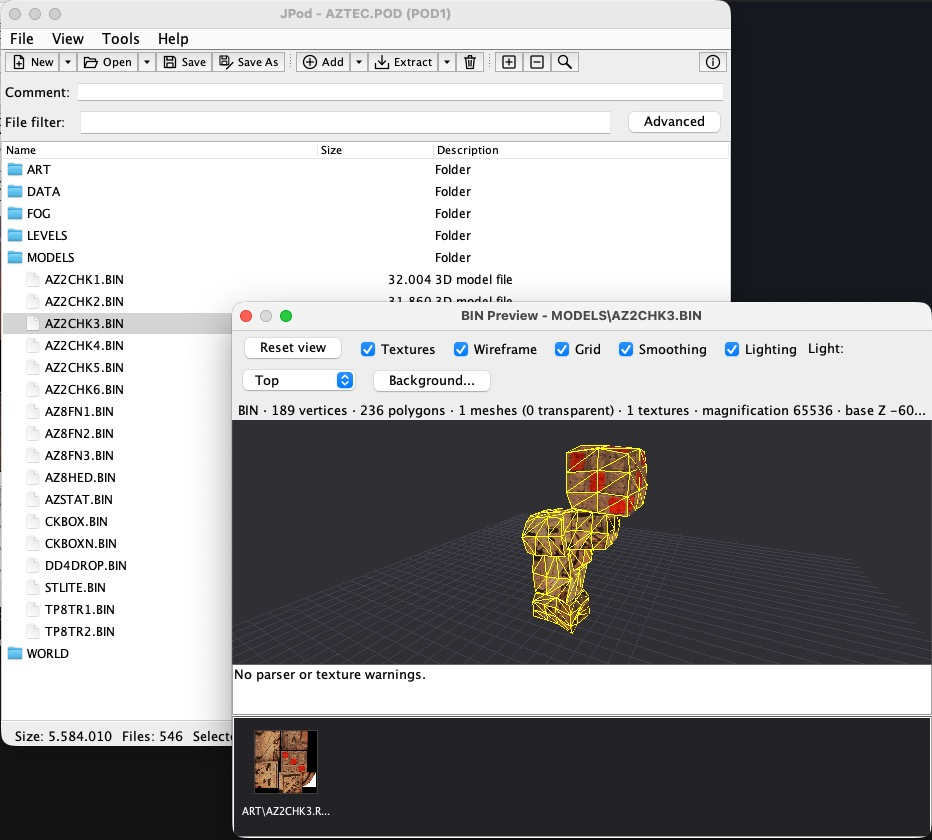

# JPod

[](#requirements)
[](#building-from-source)
[](#requirements)
[](LICENSE)

**Terminal Reality POD archive utility.**

JPod opens, browses, previews, extracts and builds the `POD` archives used by
*Monster Truck Madness 1 & 2*, *CART Precision Racing*, *Hellbender*, *Terminal
Velocity*, *Fury3*, *Nocturne*, *4x4 EVO 1 & 2* and their relatives. It reads and
writes the `POD1` directory and reads and explicitly authors `POD2`; `EPD` remains
read-only.

Written in Java 17 with Swing, so it runs on Windows, macOS and Linux with no
dependencies beyond the JDK. [KPod](https://github.com/juanputrerasm/KPod) is the
Windows-native C# port and matches it byte for byte: the same archives, the same
`.inf` and `.lst` reports, the same format names.



*Browsing `BAJA.POD` with `ART\HH4DROP.RAW` previewed against the palette stored
in its own directory field.*

---

## Supported formats

| Format | Games | Support |
|---|---|---|
| `POD1` | MTM 1 & 2, CPR, Hellbender, Terminal Velocity, Fury3 | browse, preview, extract, save |
| `POD2` | Nocturne, 4x4 Evo 1 & 2 | browse, preview, extract, explicit save/conversion, CRC, timestamp and audit history |
| `EPD` | Fly! | browse, preview, extract |

There is no POD3+ support.

---

## Features

### Archive viewing
- Open `.pod` and `.epd` archives and browse them in a file-viewer style table
  with Name / Size / Description columns.
- Folders and subfolders are shown with icons and start collapsed, so root files
  and top-level folders are easier to scan.
- Click a column header to sort by name, size or description; click again to
  reverse it, and a third time to return to archive order.
- The filter box narrows the list as you type, and it overrides collapse so a
  match is never hidden. The Advanced button opens a search dialog that jumps the
  list to a result.
- The archive comment (the 80-character POD header field) sits in an editable
  field below the toolbar.
- The ten most recently opened files are kept in a per-user JSON config in the
  operating system's preferences location. Preferences are read the first time
  something needs them rather than at launch.
- An archive path given on the command line opens straight away.

### Extraction
- **Extract All** writes every entry to a chosen folder, recreating the
  archive's subfolder structure.
- **Extract Selected** extracts the highlighted entries, with an option to
  preserve or flatten the folder structure. Selecting a folder heading selects
  everything under it.
- Payloads are streamed to disk through one buffer, so extracting a large archive
  never needs the archive in memory.

### Building and editing
- **New Archive** starts an empty archive from scratch.
- **Open Response List File** loads the existing `.lst` syntax or a
  PODTool-compatible `.rsp` with `podFilename:`, `volumeName:`, `//` comments
  and relative source paths.
- **Add Files / Add Folder** appends files or recursively imports a directory,
  via a picker or drag and drop.
- **Folder editing** creates virtual folders, renames files or folder trees, and
  moves selections by command or internal drag and drop. Archive paths use
  backslashes and keep their case and entry order.
- **Remove** drops selected entries from the in-memory list.
- **Replace** (right-click) swaps a single entry's data with a file from disk,
  keeping the original archive name.
- **Disable / Enable in Game** hides a track or truck from the game the way
  CommPatch 26 does, by renaming it to an extension the engine does not recognise:
  `.trk` becomes `.trx`, `.sit` becomes `.six`, and `.si2` becomes `.siy`. Nothing
  is deleted and nothing is re-encoded, so enabling puts the addon back exactly as
  it was. The context menu item only appears for a selection that has something to
  rename, and both commands are also in the Tools menu. Changing a track pod's
  status can trigger the multiplayer *Different Version* message, which the status
  bar says after each rename.
- **Validate Archive** checks limits, unsafe or duplicate paths, field capacity,
  payload ranges, embedded RAW palette records, checksums and the expected
  output layout.
- **Save / Save As** saves a named archive or writes a copy. The actual output
  format is confirmed before writing; POD1 is the default and POD2 must be
  chosen explicitly.

### Reports
- **Save .inf** exports a fixed-column text report: filename, total size, entry
  count, comment, and a padded name / size / offset table.
- **Save .lst** exports a plain entry-name list that the response list loader
  can read back.

### File preview
Double-click any entry, or choose Preview from the right-click menu, for a
type-aware preview:

| Extension | Preview |
|---|---|
| `.raw`, `.clr` | 8-bit paletted image with a live palette selector and Save as BMP. Art textures (64x64) are drawn at 4x with no smoothing; unknown sizes open a dimensions dialog. |
| `.act` | 16x16 colour swatch grid; hover shows the index and hex value. |
| `.wav` | Audio player with play, pause/resume, stop, a seek bar and a formatted time display. |
| `.mod` | Tracker-module playback with the same transport and seeking, built in (see [MOD playback](#mod-playback)). |
| `.png` | Alpha-preserving PNG preview over a transparency checkerboard. |
| `.tga` | Uncompressed or RLE 24/32-bit true-colour Targa preview, including alpha and image-origin flags. |
| `.bin` | 3D model viewer with textures, normal maps, material effects, lighting/wireframe/grid controls, diagnostics and clickable texture thumbnails. An animated BIN opens on frame 1 with a banner naming the frame and where it resolved from; **Play** or the **A** key steps through the frames. |
| `.smf` | 4x4 Evolution 1 and 2 models, in the same viewer. |
| `.tif` | 4x4 Evolution 2 palette-indexed TIFF, including the second sample it uses as an opacity plane. Other TIFFs go to ImageIO. |
| `.bmp`, `.jpg`, ... | Standard images via `javax.imageio`. |
| `.txt`, `.def`, `.nav`, `.lvl`, `.sit`, `.si2`, `.six`, `.siy`, `.trk`, `.trx`, `.txv`, `.lst`, `.ini`, `.cfg`, `.tex`, `.tnl`, `.ttx`, `.trn`, `.ndx`, `.veg`, `.wat` and other text formats | Scrollable monospaced text viewer. |
| Anything else | Hex dump of the first 4096 bytes. |

#### 4x4 Evolution models
`.smf` is 4x4 Evolution's static model format, a text `C3DModel` covering versions
2 to 4 including Evo 2's `v1` bump materials. It opens in the same viewer as
`.bin`, and is recognised by its magic rather than its extension, so an entry whose
name is missing or wrong still opens as the model it is.

Evo is Y-up where `.bin` is Z-up, and Evo's texture V runs top-down where `.bin`'s
does not, so the decoder converts both into the `.bin` convention as it reads. The
renderer then treats every model alike. That conversion negates Evo's Z on the way
to the screen; leaving it out renders the model as its own mirror image. Its groups
are drawn double-sided, because Evo's foliage, fences and banners are single-sided
sheets meant to be seen from behind.

Diffuse textures resolve `.png`, `.tga`, `.tif`, then `.raw`. An Evo `.raw` also
picks up its same-stem `.opa` opacity plane, which is a real 0-255 gradient rather
than a mask, so it is merged into the alpha channel instead of being reduced to the
colour key the MTM family needs. Reduced-detail LOD groups are hidden when a model
carries its full-detail pair, and kept when they are all it has.

#### Palette resolution
For `.raw` and `.clr` files the palette is resolved in this order:

1. The palette recorded in the entry's own POD directory field
2. The same base name with an `.act` extension, in the same archive directory, so
   `ART\DEMO1.RAW` takes `ART\DEMO1.ACT`
3. `METALCR2.ACT` anywhere in the archive
4. `VGA.ACT` anywhere in the archive
5. The bundled MTM1 `metalcr2.act`

The archive's own `METALCR2.ACT` outranks the bundled copy because METALCR2 is not
one palette: CPR ships a different one from MTM1 and MTM2, so the copy the pod
carries is the one known to match its art. A `VGA.ACT` in the pod says the archive
belongs to one of the flight games, and since nothing at this point tells Terminal
Velocity from Fury3 or Hellbender, that copy is the only one that can be trusted.

An `.act` whose name matches nothing is never guessed at. The preview selector
offers those last, along with the bundled CPR, Hellbender and Terminal
Velocity/Fury3 palettes and greyscale, and none of them is ever chosen
automatically. The last manual choice is remembered when another RAW offers the
same option.

Step 1 is the one that matters for MTM1, Terminal Velocity, Fury3 and Hellbender.
Their packer stored the palette each RAW was authored against in the spare bytes
of the entry's name field, and it is not derivable from the file name: on those
games' main archives a name-based guess picks the wrong palette for 8221 of 8224
RAW entries. MTM2, CPR and community archives carry no such record and fall
straight through to the name-based rules.
[`docs/POD_FORMAT.md`](docs/POD_FORMAT.md) specifies it in full.

When a RAW payload is not one of the recognized sizes, JPod offers a dialog with
the exact width and height pairs that match the byte count, a swap button, and
every palette the selector offers. The three common screen sizes are recognized
and opened directly: 64000 bytes is 320x200, 256000 is 640x400, and 307200 is
640x480.

#### Model viewer
KPod draws models with OpenGL. JPod keeps to the JDK, so it has its own software
renderer with the same camera, transform and material rules: perspective-correct
texturing with a depth buffer, front-face culling, the MTM colour key on black RAW
texels, classic transparency and Extended BIN alpha test, blend, additive,
two-sided, depth-write, tint, emissive, specular, normal-strength and TEXSOLID
material states. It needs no graphics driver, so it works the same on every
machine, including virtual machines with no 3D support. Typical game models render
in a few milliseconds.

Drag with the left mouse button to orbit, use the mouse wheel to zoom, the
left/right arrow keys to strafe, and **Reset view** to refit the model. The toolbar
controls textures, wireframe, grid, smoothing, lighting direction and background
colour.

Textures are found in `ART`, `MODELS`, `DATA`, `TEXTURES`, then the archive root
and title fallback, with PNG preferred over TGA, TIF and RAW. `_N.PNG` and
`_N.TGA` normal maps use the games' DirectX/green-down convention. A same-name ACT
remains authoritative for a RAW texture; unresolved RAW textures share the
selectable fallback palette, ranked from the point of view of a texture with no
ACT of its own. The bottom strip reports missing or non-standard assets, and
clicking a resolved thumbnail opens it in the normal image preview. An animation
frame that resolves from outside the archive is named in the diagnostics, since
that is the case that works for the pod's author and fails for everyone else.

#### MOD playback
Terminal Reality's `.mod` music is 6-channel ProTracker. KPod plays it through an
optional libopenmpt add-on; JPod has its own ProTracker player in plain Java, so
nothing needs installing. It reads the 4-, 6- and 8-channel signatures, `xCHN`,
`xxCH` and the 15-sample Soundtracker layout, and implements the ProTracker effect
set: arpeggio, portamento, tone portamento, vibrato, tremolo, sample offset, volume
slide, position jump, pattern break, the extended `Exy` commands and speed/tempo.

A song ends when it runs off its order list or returns to a row it has already
played, so a module that loops forever still gets a finite length, a working seek
bar and a time display. Rows repeated by a pattern loop do not count as a return.

### Mount in pod.ini
Adds the open archive to the game's `pod.ini` mount list. JPod treats `99` as the
recommended limit, warns when the list is already larger, and still mounts the POD
rather than blocking the action. It searches the archive's folder and its parent,
and detects duplicates.

### Performance
Opening an archive reads its directory, not its contents. A POD directory is a few
kilobytes even when the archive is hundreds of megabytes, so entry payloads stay
on disk until a preview, an extract or a save asks for one. Hellbender's 41 MB,
4341-entry `GAME.POD` opens in about 5 ms.

Saving streams too. The writer plans the directory from names and lengths, then
copies each payload through a single 64 KB buffer into a temporary file beside the
target and moves it into place, so peak memory for a save is the directory plus
that buffer regardless of archive size. Because the new archive is complete on
disk before it replaces the old one, a failed save cannot damage the original, and
saving over the archive that is open works. A POD2 checksum is accumulated as the
bytes are written rather than in a second pass. Stock POD1 and POD2 archives from
MTM2, CPR, Hellbender and 4x4 Evo re-save byte for byte.

---

## The POD1 name budget

MTM2 reads exactly one POD layout. Its directory entries are 40 bytes:
`char name[32]`, `int32 size`, `int32 offset`, holding paths of up to 31
characters. A directory table that does not validate as 40-byte records is a
malformed archive, and JPod refuses it.

JPod refuses a name that does not fit rather than truncating it. A truncated name
packs without error and then simply never resolves in game, which is far harder to
diagnose than a refusal. The whole stored record counts against the 31 bytes: the
path, its terminator, and on a `.RAW` entry any embedded palette name and its
terminator.

Authoring guidance goes further and keeps the *stem* to 18 characters, because the
engine builds sibling names from it and every derived name must still fit 31.
`ART\` plus an 18-character stem plus `_MASK` plus `.PNG` is exactly 31.

---

## Requirements

| Requirement | Version |
|---|---|
| Java runtime | 17 or later |
| Build tool (source only) | Maven 3.8+ |

No runtime dependencies beyond the JDK standard library.

---

## Getting started

Prebuilt binaries are on the
[Releases](https://github.com/juanputrerasm/JPod/releases) page. Download
`jpod.jar` and run it:

```sh
java -jar jpod.jar
```

On most desktops you can also double-click the jar, or pass an archive path to
open it directly:

```sh
java -jar jpod.jar /path/to/GAME.POD
```

1. **Open**, or pass a path on the command line.
2. Double-click a folder row to expand it, or use **Expand All** to open everything.
3. Double-click a file to preview it.
4. Select entries and press **Extract**, or use its arrow for **Extract All**.

---

## Usage

### Toolbar

Actions worth naming carry a label, the rest are icon-only with a tooltip, and the
ones that come in families sit behind a split button whose face runs the most
common of them. Everything here is also in the menus, so no action is reachable
only through a dropdown.

| Control | Face runs | Arrow opens |
|---|---|---|
| **New** | New archive | New Archive, Open Response List File |
| **Open** | Open a POD or EPD archive | Open POD, Open Response List File, recent files |
| **Save** | Save over the open archive | |
| **Save As** | Write the entry list to a new archive | |
| **Add** | Add Files | Add Files, Add Folder, Create Folder |
| **Extract** | Extract Selected | Extract Selected, Extract All |
| Remove | Drop the selected entries from the list | |
| Expand All / Collapse All | Open or close every folder | |
| Search | Open the search dialog | |
| About | Version and credits, at the right edge | |

The icons are drawn as vector strokes in the look and feel's text colour, so they
stay sharp on HiDPI displays and match light and dark themes.

### Menus

- **File**: Open POD, New Archive, Open Response List File, Open Recent, Add
  Files, Add Folder, Create Folder, Remove Selected, Save, Save As, Extract All,
  Extract Selected, Save .inf Report, Save .lst List, Exit
- **View**: Expand All Folders, Collapse All Folders
- **Tools**: Mount in pod.ini, Search, Validate Archive, Disable in Game, Enable
  in Game, Record POD2 audit history, Set Audit Author, View POD2 Audit History
- **Help**: About

### Status bar

`Size` is what the archive would occupy if saved now, which is why it changes as
entries are added and removed. `Files` and `Selected` are counts, `unsaved`
appears once the list differs from what is on disk, and the square at the right
edge turns red while an operation is running, with the status text saying what it
is. With nothing loaded the counters are hidden and the status bar says how to
start. Closing JPod with unsaved changes asks first.

---

## Building from source

Building needs a JDK 17 or later and Maven 3.8+.

```sh
mvn package          # builds target/jpod.jar
mvn test             # runs the format and manifest tests
java -jar target/jpod.jar
```

The test suite covers POD1 detection, directory-field and palette
preservation, name-length boundaries, payload bounds, POD2 checksums and audit
records, lazy reads and streamed saves, palette resolution, TGA and TIFF decoding,
BIN and SMF model decoding, entry descriptions, Disable/Enable in Game, the MOD
player's timing and loop detection, and a set of stable SHA-256 authoring vectors
shared with KPod that prove both ports emit identical bytes.

### Project layout

```
src/main/java/com/mtm2/jpod/
├── JPodApp.java                   Entry point
├── PodSession.java                Shared mutable state for the current archive
├── AppConfig.java                 Per-user config and recent files
├── io/
│   ├── pod/
│   │   ├── PodArchive.java        Archive model: directory in memory, payloads on demand
│   │   ├── PodDataSource.java     Random-access bytes behind an archive (file or memory)
│   │   ├── PodArchiveReader.java  Reads a .pod header and directory
│   │   ├── PodArchiveWriter.java  Streams a .pod to a temp file and swaps it in
│   │   ├── PodArchiveValidator.java  Pre-save and post-open validation
│   │   ├── PodEntryDescriber.java The Description column
│   │   └── PodEntryDisabling.java Disable / Enable in Game renames
│   ├── image/
│   │   ├── PaletteResolver.java   RAW palette rules and the selector's choices
│   │   ├── BundledPalettes.java   MTM1, CPR, Hellbender and TV/F3 palettes
│   │   ├── HdArtMaps.java         _N, _AO, _DTL and _MASK map roles
│   │   ├── TgaImageDecoder.java   24/32-bit TGA, RLE and origin flags
│   │   └── TiffImageDecoder.java  4x4 Evo 2 palette TIFF with opacity sample
│   ├── model/
│   │   ├── BinModel.java          Decoded model, meshes and materials
│   │   ├── BinModelDecoder.java   Classic, animated and Extended BIN
│   │   ├── SmfModelDecoder.java   4x4 Evo C3DModel
│   │   ├── BinTextureResolver.java  Texture, normal map, palette and .opa lookup
│   │   └── BinFrameResolver.java  Animated BIN frame lookup
│   ├── audio/
│   │   ├── ModModule.java         ProTracker-family module parser
│   │   └── ModRenderer.java       Tracker playback to 16-bit stereo PCM
│   ├── PodExtractService.java     Extracts entries to disk
│   ├── PodManifestParser.java     Parses .lst and .rsp response files
│   ├── PodReportExporter.java     Writes .inf and .lst reports
│   ├── PodIniMounter.java         Adds a POD to pod.ini
│   └── RawImageDecoder.java       Decodes .raw / .clr / .act image data
└── ui/
    ├── MainWindow.java            Main application window
    ├── ToolbarIcons.java          Vector toolbar icons
    ├── PreviewWindow.java         Type-aware file preview
    ├── ModelPreviewWindow.java    BIN and SMF model viewer
    ├── model/ModelRenderer.java   Software rasterizer for models
    ├── model/LoadedTexture.java   Model texture decoding
    ├── AudioPlayerDialog.java     WAV and MOD transport
    ├── audio/                     WavePlayer, ModulePlayer
    ├── BuildArchiveDialog.java    New-archive configuration
    ├── ExtractOptionsDialog.java  Extract destination and options
    ├── SearchDialog.java          Entry search
    └── AboutDialog.java

src/test/java/com/mtm2/jpod/io/
├── pod/PodArchiveFormatTest.java  Format detection, round trips, POD2, vectors
├── pod/PodLazyAndStreamingTest.java  Lazy reads, streamed and in-place saves
├── pod/PodEntryDescriberTest.java Descriptions and Disable / Enable in Game
├── image/                         Palette resolution, TGA, TIFF, RAW extras
├── model/ModelDecoderTest.java    BIN, animated BIN, SMF, texture lookup
├── audio/ModRendererTest.java     MOD parsing, timing, loops and seeking
└── PodManifestParserTest.java     Response-file parsing
```

---

## Format specification

[`docs/POD_FORMAT.md`](docs/POD_FORMAT.md) specifies the whole POD family: POD1,
POD2 and EPD. It covers the palette record
the early Terminal Reality packer stored in the spare bytes of each RAW entry's
name field, which is documented nowhere else, and it marks every claim as verified
against shipped archives, documented upstream, implemented but unconfirmed, or
unresolved. [`docs/pod-format.json`](docs/pod-format.json) carries the same
structures as machine-readable data.

## References

- [KPod](https://github.com/juanputrerasm/KPod) - the Windows-native C# port
- [Monster Truck Madness Guild](https://www.mtm2.com/%7Emtmg/index.shtml)
- [MTM2 Engine Content Limits](https://www.mtm2.com/~mtmg/misc/ENGINE_LIMITS.md)
  - extended-directory design and name budgets
- [EPD Format
  Reference](https://github.com/jopadan/termpod/wiki/EPD-Format-Reference)
- [Pod 2 Format
  Reference](https://github.com/jopadan/termpod/wiki/Pod-2-Format-Reference)

---

## Credits

Developed by **Juan Pablo Utreras** for the Monster Truck Madness Guild.

Based on the original WinPod by MDMRE.

Licensed under the [Apache License 2.0](LICENSE).

Monster Truck Madness, Terminal Velocity, Fury3, Hellbender, CPR, Nocturne and
4x4 Evo are trademarks of their respective owners. This is an unofficial,
community-made utility with no affiliation to Microsoft or Terminal Reality.